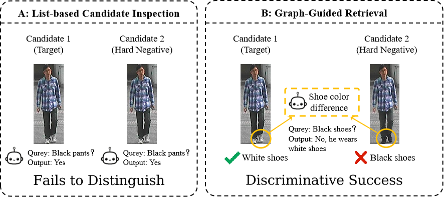
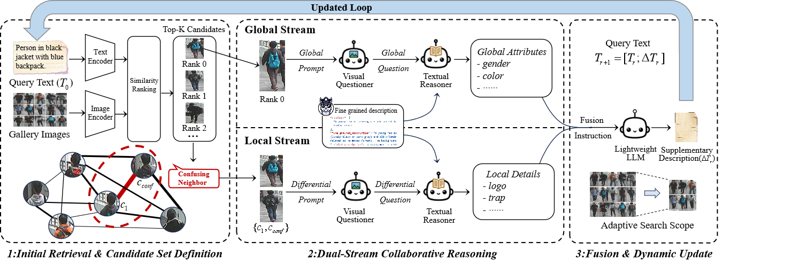

# GDS-ReID: Graph-Guided Dual-Stream Collaborative Reasoning for Text-Based Person Re-Identification

<div align="center">



[](ICME4ReID.pdf)
[](LICENSE)
[](https://pytorch.org/)

</div>

## 📖 Introduction

This repository contains the official implementation of the paper **"GDS-ReID: Graph-Guided Dual-Stream Collaborative Reasoning for Text-Based Person Re-Identification"**.

**Abstract:**
In interactive text-based person re-identification (ReID), particularly in scenarios exhibiting high visual similarity between the target and candidates, fine-grained inter-candidate differences often serve as the primary basis for distinguishing the target from distractors. However, existing methods typically treat retrieved candidates as a static and mutually independent ranked list. 

To address this, we propose **GDS-ReID**, a graph-guided dual-stream collaborative reasoning framework.
* **Visual Affinity Graph:** Constructs a graph over the candidate set to expose local ambiguity via nearest-neighbor relations.
* **Dual-Stream Reasoning:**
    * **Global Stream:** Verifies attribute-level consistency to stabilize search direction.
    * **Local Stream:** Performs neighbor-aware pairwise comparison to extract fine-grained differential evidence using mined hard negatives.

<div align="center">
  
  <br>
  <em>Figure 1: The overall framework of GDS-ReID.</em>
</div>

## 📂 Project Structure

```text
.
├── config/                 # Configuration files for training and evaluation
│   ├── Interactive-PEDES.yaml
│   ├── train_question.yaml
│   ├── train_selector.yaml
│   └── deepspeed/          # DeepSpeed configs
├── data/                   # Data processing and prompt definitions
├── img/                    # Images for README
├── model/                  # Model definitions (LLaVA-ReID, IRRA, etc.)
├── reid_datasets/          # Dataset loading scripts
├── solver/                 # Optimization and schedulers
├── utils/                  # Utility scripts
├── train_llava_reid.py     # Main training script
├── main_eval.py            # Evaluation script
├── requirements.txt        # Dependencies
└── train_question.sh       # Training launch script
